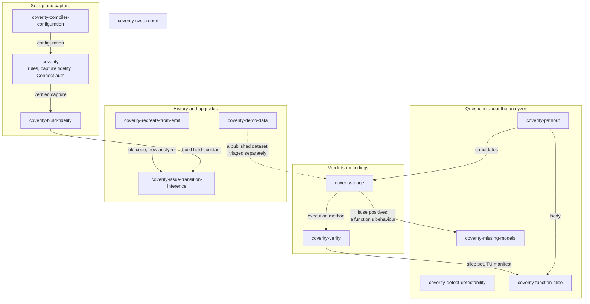
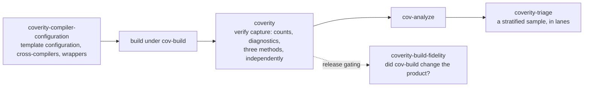
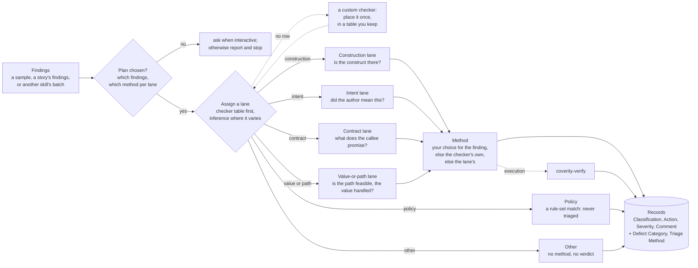
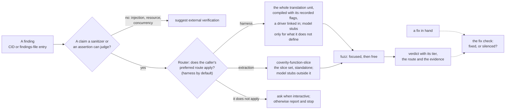
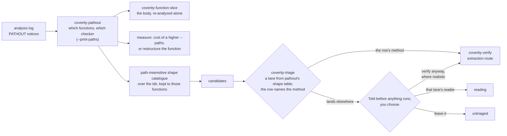
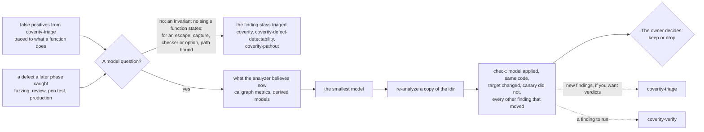
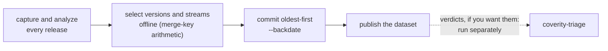
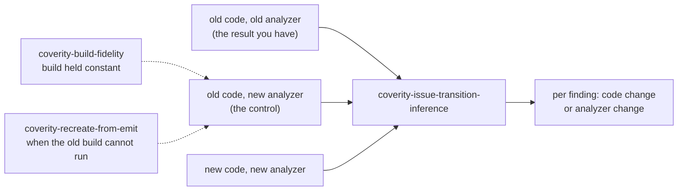

# Use cases and workflows

What you can do with these skills, organized by what you are trying to do
rather than by skill. Each use case names the skills involved, in order, and
where one hands to the next. Every skill does one job; when a question
belongs to another skill, it hands over explicitly instead of doing half of
that skill's work.

## How the skills fit together

`coverity` sits under all of them: its rules apply to any Coverity work,
it owns capture verification and Connect authentication, and it routes a
question it does not own to the skill that does.

## Get a scan you can trust

**You want:** a capture that models your real toolchain, and evidence that
the analysis covered the code before anyone acts on its results.

- `coverity-compiler-configuration` sets up `cov-configure` with templates, so
  the compiler is probed per invocation, the way the build actually runs it.
- `coverity` verifies the capture: what reached the analyzer, measured three
  ways, and reported as counts rather than a bare percentage.
- `coverity-triage` checks a sample of the results (rule 26) before the
  report leaves your hands.
- For a release gate, `coverity-build-fidelity` shows that wrapping the build
  in `cov-build` left the product unchanged, paired with capture coverage so
  the result means something in both directions.

## Triage findings by the kind of claim they make

**You want:** each finding sorted into a lane by what it claims, judged by a
method suited to that lane, with the verdict in Coverity Connect's own triage
fields and a record of which lane and method produced it.

- `coverity-triage` does this, in six lanes:
  - **Construction:** the construct does the wrong thing, or something
    undefined, for some input it can receive, whatever input actually
    arrives. It is real when the construct is there, and is never dismissed
    by arguing that the bad input is unlikely.
  - **Intent:** the code is well-defined, but a pattern suggests it may not do
    what its author meant, which the checker cannot know (a copy-paste slip, a
    missing `break`, a `sizeof` of the wrong thing, dead code).
  - **Contract:** a call ignores a failure its callee can report, or uses a
    result that can be invalid.
  - **Value or path:** a value or state reaches a point, along a path, that
    does not handle it.
  - **Policy:** a match against a rule set, a list of calls not to make or a
    threshold, with no claim that the code misbehaves. The record carries the
    lane and nothing else.
  - **Other:** none of the above fits, or the finding is not a claim about
    the code at all (a parse error is a capture problem, for the `coverity`
    skill); no verdict.
- Most checkers make one kind of claim, so a checker table assigns the lane;
  only the findings of the few checkers whose claims vary are assigned by
  reading the events.
- A custom checker the table does not know is placed once, before anything
  runs: from rows its producer ships, from the built-in checker it stands in
  for, or from its description. You see the proposed rows, and they go into a
  table file you keep, so the next run asks nothing.
- Each lane has a preferred method: a reading by a model you name, execution
  through `coverity-verify`, or a person. Different lanes can use different
  models. A checker built for one method keeps it whatever its lane, and your
  choice for a single finding overrides both. No lane rules a method out:
  Intent findings are well-defined code with nothing to crash, so a reading
  suits them, but nothing forbids another method. Policy takes no method,
  ever; Other takes none unless you give one to a finding, with the reason.
- Nothing runs until you have chosen which findings and which methods, because
  every method costs time per finding. Run unattended, it assigns what the
  table can, then reports the plan it needs and stops.
- A skill that hands its findings over can say which lane it expects. A
  finding that lands elsewhere is reported to you before any method runs.
- The output is a records file in Connect's attribute names. Applying it to
  Connect, with or without the two custom attributes, is up to whoever owns the
  instance.
- A defect a reader notices while judging a different finding (a by-catch)
  goes to a `bycatch/` folder of its own, never into the records or the
  report, so nothing that travels with the verdicts carries it.

## Settle one finding by running it

**You want:** a definitive answer on one finding (a CID, an entry in a
findings file) instead of a debate about it; or, for a finding that
disappeared between two versions, whether the change fixed the defect or
only silenced the analyzer.

- `coverity-verify` does this. Its one method runs on one of two routes,
  with the same verdict tiers on both:
  - **Harness:** the translation unit's real source, compiled as the build
    compiled it, with a driver linked in and the original function run
    unchanged. Only the externals the unit does not define are stubbed, from
    Coverity's own models of them. It is the cheaper route and the default.
  - **Extraction:** the slice set from the emit, printed by
    `coverity-function-slice`, with every callee outside the set stubbed from
    its model. It is the route `coverity-pathout`'s shapes were built for, and
    the one for a program the harness route cannot take, or a defect type
    that has been shown to need it.
- The caller names the route it prefers: `coverity-pathout`'s shapes prefer
  extraction, other callers harness. A user whose program does not suit the
  harness route overrides it for that program. When the preferred route
  does not apply, the router never switches on its own: it asks in an
  interactive session, and otherwise reports why and stops.
- Run on a batch, verification is one method of `coverity-triage`, and a
  checker's table row can carry the route it prefers.

## Look where the analyzer reached its path bound

**You want:** to know which functions reached the per-function path limit,
which checker it cut short, what the analyzer did not examine there, and what
raising the bound would cost.

- `coverity-pathout` finds the functions and the checker, runs the shape
  catalogue there, and measures what a higher bound costs. With many
  functions at the bound, it pilots one, prices the rest (triage of each
  candidate included) and asks before going on.
- Its candidates are built to be run. `coverity-pathout` ships a row per shape
  for `coverity-triage`'s table, naming the lane of the built-in checker the
  shape stands in for and the method, execution through `coverity-verify` on
  the extraction route, the chain the shapes were built for. A row's method
  overrides its lane, so a
  candidate standing in for a Contract or Construction checker still goes to
  `coverity-verify`.
- They still pass through `coverity-triage`'s lane assignment, which is cheap
  and checks that each candidate's claim is what the shape assumed. A
  candidate that lands elsewhere is reported before any method runs, and you
  choose: verify it anyway where that is realistic, run that
  lane's reader, or leave it untriaged. Any choice is fine; none happens by
  surprise, and the record says which one you made.

## Answer "can Coverity find this?"

**You want:** an empirical verdict on whether Coverity reports a specific
defect, the minimal configuration that does, and a command to reproduce it.
Typical cases are comparing against another tool, answering an RFP, or
investigating a miss.

- `coverity-defect-detectability`: capture, run the defaults, escalate only
  while the answer is still "not found", then narrow to the minimal setting.
  It checks that the verdict carries over to the real code.

## Teach the analyzer what a function does

**You want:** fewer false positives, or defects the analyzer starts
reporting, because it now knows what one function really does: it never
returns, frees or keeps its argument, never returns NULL, initializes its
output.

- `coverity-missing-models` does this. Two things start it: false positives
  that `coverity-triage` traced to what a function does, and a defect that a
  later phase caught because the analyzer did not know a function's behaviour.
- For a false positive, it first checks that the invariant is a fact about
  one function. One that is not, such as a relation between the caller's
  values, stays a triaged finding.
- For an escape, it first rules out the cheaper answers: the capture
  (`coverity`), the checker or option (`coverity-defect-detectability`), the
  path bound (`coverity-pathout`).
- It proves what the model changed on a copy of the intermediate directory,
  and the owner decides whether to keep it. Each re-analysis is a full
  analysis of that copy, so it asks before each one; unattended, it writes and
  builds the model and stops. Triaging the findings a model
  surfaces is `coverity-triage`'s job and is opt-in: it is offered, with the
  count.
- What it learns is kept in the skill's `references/idioms.md`. It is the
  detection loop's *write a model or fact, feed it back as analyzer input*
  step ([`collateral/detection-loop/`](collateral/detection-loop/README.md)).

## Adopt Coverity on a codebase that already has history

**You want:** findings dated to the release they arrived in, rather than to
the day the tool was installed. The same applies when migrating from another
tool, or preparing a demo, POC or training instance.

- `coverity-demo-data` builds the history: one stream per branch, commits in
  global date order, the commit phase guarded because first-detected dates can
  be written only once.
- It does not triage. If you want verdicts on a published dataset's findings,
  run `coverity-triage` against it yourself.

## Upgrade Coverity without confusing tool changes with code changes

**You want:** for each finding that appeared or disappeared across an
analyzer upgrade, whether the code changed or the analyzer did.

- `coverity-issue-transition-inference` adds the missing control run, the old
  code under the new analyzer, which splits one confounded delta into two.
  The control decides both directions: for a finding that appeared, whether
  you wrote it or the analyzer changed; for one that disappeared, whether you
  fixed it or the analyzer stopped reporting it.
- When the old build can still be run, `coverity-build-fidelity` keeps it
  constant. When it cannot, `coverity-recreate-from-emit` rebuilds an
  analyzable intermediate directory from the old one.

## Reuse or recover an intermediate directory

**You want:** to analyze an old capture with a newer analyzer when the build
is gone; or to avoid a slow capture by bringing an existing idir up to date
with your tree.

- `coverity-recreate-from-emit` covers three situations:
  - **Recreate:** the build cannot run.
  - **Fast-forward:** catch a CI idir up to `HEAD`.
  - **Local update:** include uncommitted work.
- Fast-forward and Local update reuse an idir on purpose, against the usual
  rule. The skill runs the gates that decide when that is safe, and says no
  when it is not.

## Get one function as the analyzer saw it

**You want:** a single function out of an intermediate directory, as a file
that compiles and analyzes on its own. Typical uses are a minimal reproducer,
iterating without a rebuild, or a support ticket, with an obfuscated twin
that is proven to analyze identically.

- `coverity-function-slice` does this.

## Put CVSS scores on findings, and know which scores were judged

**You want:** the CVSS report, and to know which of its zeros were deliberate
and which came from a CWE with no mapping.

- `coverity-cvss-report` runs the report the documented way. It audits every
  score into decided-zero, scored, or unmapped, and records that in a triage
  attribute.

## Connect to Coverity Connect

**You want:** an authentication key that works, kept where it belongs.

- `coverity` creates the key, checks it over REST, and revokes it. The key
  never lives in a repository, and the connection URL is taken from you, never
  from the key file.

## What each skill does, and does not

| Skill | Does | Does not | Hands off to |
|---|---|---|---|
| `coverity` | standing rules; pinning one installation; reading an idir; verifying capture three ways; Connect authentication; routing | a specialist's job; explaining a noisy sample beyond re-checking capture | the specialist skill the question belongs to |
| `coverity-compiler-configuration` | template configurations; cross-compilers, embedded toolchains and wrappers; diagnosing and regenerating a tainted configuration | verifying the capture; judging the build | `coverity` (capture verification) |
| `coverity-build-fidelity` | native vs `cov-build` comparison of the product; capture coverage; a release-gate verdict and a profile draft | guessing at unexplained differences (it escalates to a person); work where the build cannot run | `coverity-recreate-from-emit` when the build cannot run |
| `coverity-defect-detectability` | an empirical detectability verdict; the minimal configuration; a repro command | triaging real findings; speculating about what a checker would do instead of running it | `coverity-triage` for verdicts on findings |
| `coverity-missing-models` | the smallest user model for a function whose behaviour the analyzer gets wrong; proof on a re-analyzed copy (model applied, same code, target, canary, every other finding that moved); what was learned, in `references/idioms.md` | deciding to keep a model (the owner does); triaging the findings a model surfaces; capture, checker selection and the path bound (ruled out first) | `coverity-triage` (new findings, opt-in), `coverity-verify` (a finding to run) |
| `coverity-demo-data` | a multi-version history with real release dates; streams per branch; guarded oldest-first commits; a self-contained published dataset that keeps each release's findings export and capture inventory | triaging, on request or otherwise (run `coverity-triage` on a published dataset yourself); the customer narrative; backdating triage history | nothing: triage is run separately |
| `coverity-pathout` | which functions reached the path bound and which checker; the shape catalogue there; the cost of raising the bound; restructuring; a priced pilot before a large run | judging its candidates; analyzing an idir from a version that is not installed (it stops and asks) | `coverity-function-slice` for bodies; `coverity-triage` for candidates, through its own shape table (method: execution through `coverity-verify`, extraction route); anything that lands elsewhere goes to the user |
| `coverity-function-slice` | one function from the AST; a standalone file that compiles and analyzes; an obfuscated twin with proof; a manifest of a whole translation unit for the harness route | deciding whether a finding is real | `coverity-pathout`, `coverity-verify` (its callers) |
| `coverity-verify` | an execution verdict on one finding, on the caller's preferred route (harness by default, or extraction), with its tier, the route and the evidence; the fix check | injection, resource and concurrency claims (it suggests external verification); switching route on its own; triaging a batch by reading | `coverity-function-slice` for the slice set and the translation-unit manifest |
| `coverity-triage` | a lane per finding (construction, intent, contract, value or path, policy, other), from a checker table where the checker decides it; a custom checker placed once, in a table you keep; a method and model per lane, which a checker's own method overrides; records in Connect's fields plus Defect Category (the lane) and Triage Method; policy findings recorded, not triaged | choosing the findings; writing to Connect; severity beyond "low"; exploitability; Connect's AI-Assisted Triage; demo-worthiness | `coverity-verify` for the execution method |
| `coverity-issue-transition-inference` | the control run; per-finding code-vs-analyzer attribution; annotation, after asking how | comparing raw merge keys (Connect lines findings up); vendor-level cause as the headline | `coverity-build-fidelity`, `coverity-recreate-from-emit` for the control |
| `coverity-recreate-from-emit` | an analyzable idir without the original build; fast-forward and local-update reuse, behind gates | reuse when a gate fails; the default path when the build can run | `coverity-issue-transition-inference` (its consumer) |
| `coverity-cvss-report` | the report per the documentation; an audit of which scores were judged; the CVSS_Audited attribute | writing a security profile; judging exploitability | `coverity-verify` for whether a finding is real and reachable |
