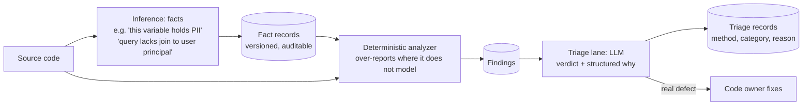
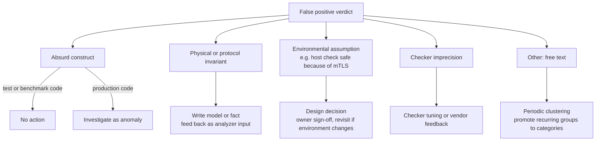
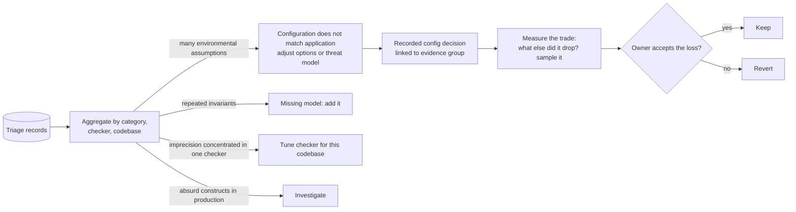
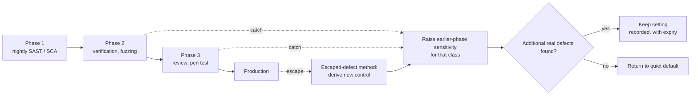
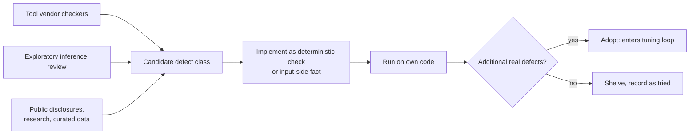

# Detection, Triage, and Tuning Loop

A process where deterministic analyzers do what they're best at, inference does what it's best at, and every inference step leaves a record that can be audited. Each diagram is one loop. They share the same triage records.

## 1. Defect loop: inference on both sides of the analyzer

Inference provides **facts as input** (things only reading the code reveals) and **judgments on the output**. The analyzer tracks the data flow between them.

**Rule:** where the analyzer doesn't model a construct, it should over-report. The LLM can discard a false positive, but it can't recover a finding the analyzer never produced. Silent pruning inside the analyzer is how real defects get lost.

## 2. False-positive reasons are categories, and each one leads to an action

"Absurd" is one category among several. The list starts as free text and settles on a small fixed set.

The share of reasons that land in "other" shows whether the categories have settled.

## 3. Meta-triage: patterns across triage decisions change the configuration

Every configuration change drops some real findings. The trade can't be avoided. It must be visible, measured, and deliberately accepted.

## 4. Sensitivity across SSDLC phases

A catch in a later phase raises sensitivity in an earlier phase for that defect class. Settings stay only while they keep finding additional real defects.

- Later phases act as cheap, early sensors for earlier ones, so sensitivity settles around very good values.
- A single-phase program gets only production escapes as its signal: rare, expensive, and late.
- **Ceiling:** the settled values can only be as good as what the last phase can see. A class that no phase detects never sends a signal.

## 5. New defect classes

Tuning improves detection you already have. New classes need their own input.

An exploratory LLM review may give different answers each run. That's acceptable here, because its output is a hypothesis, not a finding to track. The hypothesis is accepted or rejected by the same measure as everything else: does it find additional real defects?

## Principles

- Inference produces **records you control**: facts on input, categorized judgments on output. It never produces silent decisions.
- Analyzers over-report what they don't model, and triage removes noise where it can be seen.
- Every trade between noise and missed defects is recorded, measured, and owned.
- Signals come from later phases of your own process, not from customers.
- A control is accepted because it finds **additional** defects, not because it re-finds the one that prompted it.
