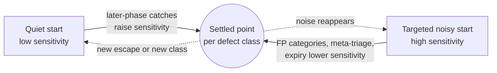
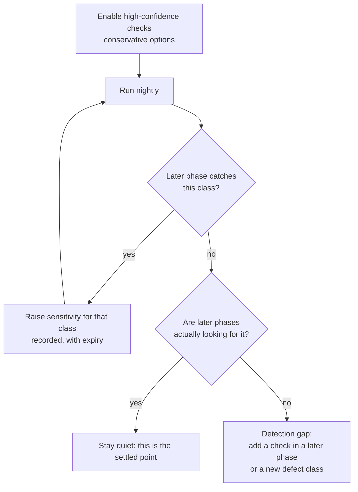
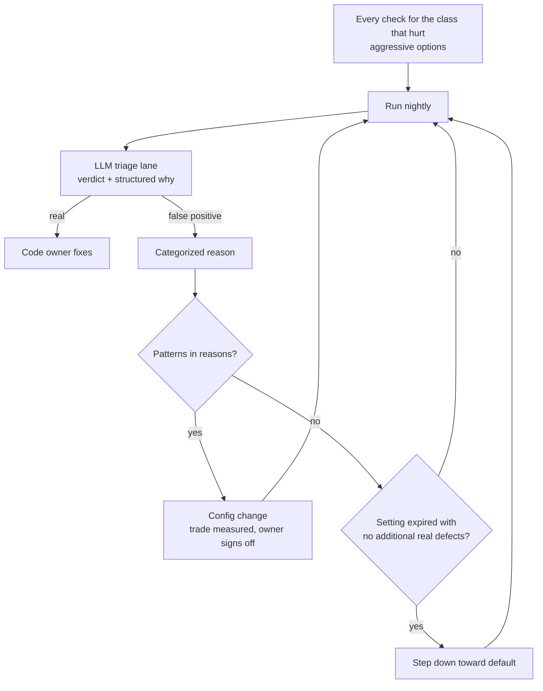

# Starting Positions: Quiet First or Targeted Noise First

Companion to [ssdlc-detection-loop.md](ssdlc-detection-loop.md). That document describes a loop that settles each defect class at a sensitivity that suits it. This one covers where an organization starts the loop, and why the starting point matters less than it seems.

## The two philosophies

Organizations rarely start out wanting the settled point. They start on one side of it:

| | **Quiet first** | **Targeted noise first** |
|---|---|---|
| What they say | "We don't want any false positives." | "This defect type hurt us recently. Show us everything." |
| Where it comes from | Past tools that buried developers in noise | A recent incident, audit finding or customer escape |
| Initial setting | High-confidence checks only, conservative options | Every check for the class that hurt, aggressive options |
| What it costs at first | More defects pass through to later phases | Heavy triage load on those classes |
| Main risk | Weak later phases send no signal, so it never moves and looks like success | Developers give up before the noise comes down |

Most organizations are both at once: quiet by default, noisy for one or two classes. The loop handles that, because sensitivity is set **per defect class**, not globally.

## Why the start doesn't decide the end

The same two forces act on every class, wherever it starts:

- **Up:** a later phase catches something an earlier phase should have caught.
- **Down:** triage keeps categorizing a class's findings as false positives, and meta-triage turns that into a configuration change, or a temporary setting expires without having found anything new.

The starting position only changes which force does the work first.

A thermostat is a useful way to explain this. It doesn't matter whether the room starts cold or hot. It settles at the set point, provided the thermostat is connected. What decides the outcome is that the sensors (later phases) and the controls (triage categories, meta-triage) are connected.

## Starting quiet

- **Watch:** how often later phases catch each class.
- **The trap:** silence looks the same as success. A quiet start is only safe when later phases are actually looking for the class. Otherwise the loop has no sensor and the setting never moves.

## Starting with targeted noise

- **Watch:** false-positive rate and triage volume for each class, and how many additional real defects the noise turns up.
- **What's different now:** the triage lane takes most of the noise before developers see it. Historically, noisy starts failed because developers had to read every finding. With LLM triage in front, the cost of starting noisy moves from developer attention to tokens, which is a much cheaper place to pay it.
- **The trap:** overcorrecting after the next incident by making *everything* noisy. Keep the noise to the class that hurt.

## What to record at the start

Treat the starting position as a decision like any other:

- **Per defect class:** the starting sensitivity and why ("quiet: past tool fatigue"; "noisy: CWE-89 escape in Q3").
- **The direction you expect it to move,** and the measure that will show it moving.
- **The expiry** for any noisy setting.
- **The sensors** that will move a quiet class, by name. If you can't name a later phase that would catch it, that's a gap to fix before relying on quiet.

## How you know it has settled

- Later phases rarely catch what earlier phases should have caught.
- Each class's false-positive reasons are mostly expected categories, such as environmental assumptions already documented, rather than "other."
- Configuration changes become rare and small.
- Noisy settings expire on schedule without being renewed.

The two philosophies end up in the same place. One reaches it by accepting a few escapes into later phases, the other by spending tokens on triage. Choosing between them is a question of which cost the organization would rather pay first.
