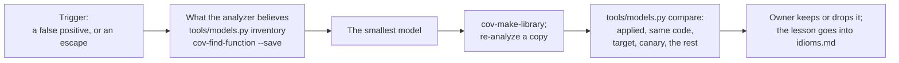

# coverity-missing-models

Part of [CoveritySkills](../README.md).

Writes a Coverity **user model** when one makes the analysis more faithful,
and proves what it changed. Coverity derives a model of every function and
uses it at every call; where that model is wrong or missing, every caller
inherits the mistake. A user model replaces it with a statement of what the
function really does.

Two things start it, the two places the
[detection loop](../collateral/detection-loop/ssdlc-detection-loop.md)
feeds a model back into the analyzer:

- **False positives from triage** whose invariant is a function's
  behaviour: it never returns, it frees its argument, it never returns
  NULL. [coverity-triage](../coverity-triage/README.md) records the
  invariant, where it is enforced, and what would break it; the model makes
  it permanent for every caller.
- **A defect that escaped to a later phase** (fuzzing, review, a pen test,
  production) because the analyzer did not know what a function does: a
  custom allocator or arena, a free wrapper, an exit through a hook, an
  external with no source, or project code that shares a name with one of
  Coverity's built-in models.



## What the skill knows that saves time

- **A model that matches nothing is silent.** It builds, the analysis
  runs, and nothing changes, with no warning from either tool. The only
  proof it applied is positive: the function's entry in
  `output/callgraph-metrics.json.gz` reads `user1`. `tools/models.py
  compare` checks it for every function the model source defines.
- **A user model replaces the derived one entirely.** A model that only
  frees drops the unlink a caller's loop depended on, and that loop turns
  into a double free. Read the derived model first
  (`cov-find-function --save`) to see what has to be restated.
- **Project code with a built-in model's name is not analyzed as written.**
  Built-in models outrank derived ones, and Coverity ships a model for
  `error()`, `fatal()`, `die()`, `stop()` and more, all of which end the
  path. A project `error()` that logs and returns hides every defect after
  it. `tools/models.py inventory` lists every such function.
- **For an arena allocator, model the owner, not the arena.** An object
  carved out of an arena is not an alias of it, so modeling the arena's
  destroy as a free does not report uses of the objects in it; modeling
  the release function of an object that owns its arena does.
- **Every finding that moves gets read.** A model can hide real defects as
  easily as it removes false ones, and it can create findings of its own.
  The compare step lists every new and every gone finding, per checker,
  marking those whose trace runs through a user model.
- **Knowledge accumulates.** `references/idioms.md` holds each idiom with
  its model, its cost, its check and its fixture. The next model starts
  there, and every new lesson is added there.

## What it will not do on its own

**Re-analyze.** Each check is a full re-analysis of a copy of the
intermediate directory. Interactive, the skill says what one iteration
costs and asks first; unattended, it writes and builds the model, prints
the commands and stops.

**Keep a model.** Whether a model's trade is worth it belongs to the owner
of the analysis configuration. The skill gives the evidence.

## Layout

```
coverity-missing-models/
├── SKILL.md                   # trigger → model question? → beliefs → model → build → re-analyze → check → decide → record
├── CALIBRATION.md             # what was run, on which versions, and what was not
├── references/
│   └── idioms.md              # how a user model behaves; one entry per idiom; what is not a model
├── tools/
│   └── models.py              # inventory: where each model came from; compare: what a model changed
└── evals/
    ├── evals.json             # behaviour: model question or not, the checks, asking before re-analysis
    ├── run.sh                 # every fixture end to end, with what must change and what must not
    └── fixtures/              # killpath, collision, arena, pitfalls
```

## Requirements

- An analyzed intermediate directory, the Coverity installation that wrote
  it, and the analysis options it was run with.
- Disk for a copy of the idir, and the time of one analysis per iteration.
- Python 3, standard library only.
- For `evals/run.sh`: a shell with `cp -a` (on Windows, Git Bash); the
  fixtures need no compiler, since they are captured with `cov-emit` alone.
