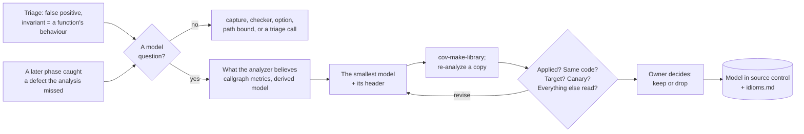

# Coverity missing models

Coverity derives a model of every function it analyzes and uses it at
every call. Where the derived model is wrong or missing, every caller
inherits the mistake: findings that cannot happen, or defects nobody is
told about. A user model replaces the function's model with a statement of
what it really does.

This is the *write a model or fact, feed it back as analyzer input* step of
the detection loop (`collateral/detection-loop/ssdlc-detection-loop.md`):
an invariant that triage found is turned into input, and so is the lesson of
a defect that a later phase caught. Writing the model is the easy part. The
skill is about two other things:

- **proving what the model changed**, because a model that matches nothing
  is silent, and a model that drops a behaviour creates findings of its own;
- **keeping what was learned**, in `references/idioms.md`, so the next model
  starts from it.



Read `coverity/RULES.md` first: rules 3, 16, 20, 22, 23, 30, 33 and 38
carry the weight here.

## Step 0: Inputs

| input | where it comes from |
|---|---|
| the analyzed idir | the run the false positives or the miss came from |
| the installation that wrote it | rule 3; models are built and read per version |
| the analysis options of that run | line 1 of `output/summary.txt`, or `cmdline:` in `output/analysis-log.txt`. The run with the model must use the same ones |
| the source at the analyzed version | to read the function, its callers, and every finding that moves |
| the trigger | **false positive:** the `coverity-triage` records (`triage.json`), or the findings and the argument. **Escape:** the defect: file, line, class, and how it was found |

## Step 1: Is it a model question?

**From triage.** A `false positive - global invariant` names the invariant,
where it is enforced, and what would break it (rule 30). It is a model
question when the invariant is **a fact about what one function does**:

- it never returns (idiom 1);
- it frees, closes or keeps its argument; it allocates;
- it never returns NULL, or returns NULL only when its argument is NULL;
- it initializes its output, or sanitizes or checks its input;
- it takes or releases a lock.

The function to model is the one whose behaviour carries the invariant,
usually a callee on the path, never the function the finding is in. The
same function named by several records is the strongest candidate (the
loop's meta-triage), but one record is enough to start. Not a model: a
relation between values no single function states, an environment
invariant, a heuristic misfire, an `intentional` (`references/idioms.md`,
*Not a model*).

**From an escape.** First rule out the earlier arrows of rule 16, in order:
the code was captured (`coverity`, rules 2 and 20), the checker ran
(`output/enabled-checkers.json`), no option or aggressiveness level decides
it (`coverity-defect-detectability`), the function did not reach the path
bound (`coverity-pathout`). A model is the answer when the defect's path
runs through a function whose model lacks the behaviour the checker needs:
the free that `USE_AFTER_FREE` needs, the NULL return `NULL_RETURNS` needs,
the taint a security checker needs.

**What it costs, and who decides (rule 38).** Writing a model and building
the library take seconds. Each check is a **full re-analysis** of a copy of
the idir, at the original run's cost in time and disk. Interactive: say what
one iteration costs and ask before the first re-analysis. Unattended, or
unsure: write the model and its header, build the library, print the copy
and analysis commands, and stop. The model is on disk; the run continues
from it.

## Step 2: What the analyzer believes now

```bash
python3 tools/models.py inventory --idir <idir>                 # the whole callgraph
python3 tools/models.py inventory --idir <idir> --name <fn> ... # these functions
```

It reads `output/callgraph-metrics.json.gz` and lists, per function, where
its model came from:

- **user models applied:** `user1`, `user2`, ... with the libraries they
  came from;
- **project code analyzed with a built-in model of the same name:** the
  library's model wins over the code (idiom 2). Read every one: each is a
  place where the analysis is not of your code;
- **no model at all:** externals with no implementation in the capture,
  ranked by importance. A model of one of these is how the analysis learns
  what a library it never saw does.

Then the derived model of the function you mean to replace:

```bash
<bin>/cov-find-function --dir <idir> --save -of <dir> --module generic <fn>
```

`<key>.generic.dot` is an automaton whose edges are the behaviours the
analyzer derived (`returnsnull`, `dereference(<arg 0>)`, `escape(...)`,
`escape_to_global(...)`, `write(...)`). It shows two things: the behaviour
that is missing, and **everything your model must restate** to keep,
because the user model replaces it all (*How a user model behaves*).

## Step 3: Write the model

Look in `references/idioms.md` first: the idiom may already be there, with
its model and its costs.

- **State the one behaviour, at the level where it is true.** For an arena,
  that is the function that releases an object owning its arena, not the
  arena's destroy (idiom 3a).
- **Keep the real function's other behaviour** where callers depend on it:
  its early return on a NULL argument, a side effect a caller's loop needs
  (idiom 3b), calls it makes that matter.
- **Never stronger than the code.** A model that says "never returns NULL"
  of a function that can, or "never returns" of one that does in some build,
  hides real defects.
- **The pitfalls:** no arithmetic in a model; no redeclaring `size_t` or any
  other type `primitives.h` declares; a C++ model must match the mangled
  signature (*How a user model behaves*).
- **A header on every model:** what triggered it (the finding or the
  escape), the invariant as a proposition, where the code enforces it, and
  what would break it. A model is a dismissal made permanent for every
  caller, so it needs rule 30's three parts more than a single verdict does.

Primitives: `<install>/library/primitives.h`, the customizing guide's
*Models and primitives* chapter, and the shipped models under
`<install>/library/generic/` as examples.

## Step 4: Build the library

```bash
<bin>/cov-make-library --output-file <lib> <models.c> [<more.c> ...]
```

Check the exit status and that `N models successfully merged into output
file.` counts every function you wrote. `<lib>` is written as named.

## Step 5: Re-analyze a copy

Never the original: its results are the baseline.

```bash
cp -a <idir> <idir-copy>                     # timestamps kept (rule 33); robocopy /E /COPY:DAT /DCOPY:DAT on Windows
<bin>/cov-analyze --dir <idir-copy> <the original run's options> --model-file <lib>
<bin>/cov-format-errors --dir <idir>      --json-output-v10 before.json
<bin>/cov-format-errors --dir <idir-copy> --json-output-v10 after.json
```

`--model-file` may be given more than once; the first is `user1`.

## Step 6: Check what changed

```bash
python3 tools/models.py compare --before <idir> --after <idir-copy> \
    --before-findings before.json --after-findings after.json \
    --model-source <models.c> \
    --expect gone=<target> --expect kept=<canary>       # false positive
    # or: --expect new=<target> --expect silent=<canary> # escape
```

A spec is a merge key or `path:line[:CHECKER]`, the path matched as a
suffix. The tool fails when any of the first four checks fails:

1. **The model applied.** Every function the model source defines shows a
   `userN` model, and the library is listed. Nothing else proves it: a
   misspelled model changes nothing, silently.
2. **The same code was analyzed.** Files, lines of code and functions match
   `summary.txt` before and after (rule 20). Paths may differ: a model
   changes which paths are explored.
3. **The target.** The false positive is gone, or the escaped defect is
   reported.
4. **The canary, in the other direction.** For a false positive: a real
   finding that runs through the same reasoning is kept. For an escape: a
   twin site that must stay silent is silent, such as the same call on an
   object that is still alive. A model that fires on the twin frees the
   wrong thing.
5. **Everything else that moved.** The tool lists every new and every gone
   finding, per checker, and marks those whose trace runs through a user
   model. **Read each one.** A new finding is either real or caused by
   something the model left out (idiom 3b). A gone finding is either a
   false positive the model removed or a real defect the model hid. Rule 30
   applies to each call, in both directions.

New findings in your code are findings. Triaging them in bulk is
`coverity-triage`'s job, and it is opt-in: offer it, with the count.

## Step 7: The owner decides

Hitting the target shows the model is right. It does not show the model is
worth keeping. That depends on the rest of the diff, and the decision
belongs to the owner of the analysis configuration (the loop's *Owner
accepts the loss?*):

- **Keep** a false-positive model that removed what it was meant to and
  hid nothing real. Keep an escape model that finds the escaped defect and
  whose other new findings are real, or are noise the owner accepts. The
  loop's measure for a control is the *additional* real defects it finds.
- **Revise** (back to Step 3) when the diff shows a behaviour the model
  dropped.
- **Drop** when the cost is more than the gain, and record that it was
  tried.

A kept model is configuration. Its source goes into source control beside
the analysis configuration, every analysis passes `--model-file`, and the
library is rebuilt from that source on every Coverity upgrade (a later
version cannot read an earlier version's library).

## Step 8: Record what was learned

- **In the project:** the model source with its header, and beside it a
  short log per model: the trigger, the version, the counts per checker
  before and after, the target, the canary, and the call on each finding
  that moved.
- **In this skill:** when the lesson holds beyond one codebase (a new
  idiom, a new pitfall, a primitive that behaves unexpectedly), add it to
  `references/idioms.md` as `CONTRIBUTING.md` requires: in neutral words,
  with a fixture under `evals/fixtures/` that shows it and a case in
  `evals/run.sh`, marked measured (with the version) or reasoned. Nothing
  from the codebase where it was learned goes into the entry.

## Step 9: Report

Lead with the verdict (rule 21): *"model of `doc_close()`: the read after
close at `arena.c:164` is now reported; the open twin is silent; no other
finding moved; Coverity 2026.9.0."* Then the counts per checker, every
finding that moved with its call, and what was not checked (rule 22): the
callers not read, whether the model holds in every build configuration,
any finding left unread. Mark which calls were measured and which were read
(rule 23).

## Anti-patterns

- Taking "no new findings" or "the false positive is gone" as proof that the
  model applied. Check `userN`.
- Modeling the function the finding is in instead of the callee whose
  behaviour is missing.
- A model stronger than the code: "never NULL", "never returns", "frees" of
  a function that does so only sometimes.
- Modeling an arena's destroy and expecting uses of its objects to be
  reported (idiom 3a).
- Re-analyzing the original idir, or the copy with different options.
- Accepting a model on its target alone, without reading every finding that
  moved.
- A model with no header: nobody can tell later what it assumed, or when it
  stopped being true.
- A model library kept without its source.
- Reaching for a model when Step 1 points elsewhere: capture, a checker, an
  option, the path bound, or a finding that should simply stay triaged.

## Where other skills take over

| Question | Skill |
|---|---|
| Was the code captured? Is the run sound? | `coverity` (rules 2, 9, 16, 20) |
| Which checker or option reports this defect class? | `coverity-defect-detectability` |
| Did the function reach the path bound? | `coverity-pathout` |
| Verdicts on findings, including the ones a model surfaced (opt-in) | `coverity-triage` |
| Run a finding to confirm it | `coverity-verify` |

## Layout

```
coverity-missing-models/
├── SKILL.md
├── README.md
├── CALIBRATION.md             # what was run, on which versions, and what was not
├── references/
│   └── idioms.md              # how a user model behaves; one entry per idiom; not a model
├── tools/
│   └── models.py              # inventory: where each model came from; compare: what a model changed
└── evals/
    ├── evals.json
    ├── run.sh                 # every fixture end to end, with what must change and what must not
    └── fixtures/
        ├── killpath/          # a false positive: an exit the analyzer cannot follow
        ├── collision/         # an escape: project code with a built-in model's name
        ├── arena/             # an escape: use after the arena went; owner vs arena models
        └── pitfalls/          # a model that matches nothing; a redeclared size_t
```
