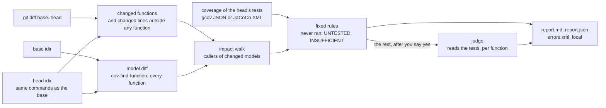

# coverity-test-advisor

Part of [CoveritySkills](../README.md).

Finds the behaviour a change introduced that the tests do not exercise,
before the change is pushed. Line coverage says which lines ran; Test
Advisor asks whether the **behaviour that changed** was exercised, through
every function the change can reach.

It uses what Coverity already knows about the code. Coverity derives a
model of every function's interface behaviour (dereferences its argument,
may return NULL, a taint sink, a new bound on a parameter), and every
caller sees it. When a function's derived model changes between the base
and the head of a change, its callers face different behaviour although
their code did not change, so they are judged too.



## What the skill knows that saves time

- **Every line can run and the change still go untested.** On jansson
  v2.15.0 to v2.15.1, a new recursion-depth limit came with tests, but
  all of them nest arrays. `json_object_deep_copy` and
  `json_object_equal` take the new depth parameter too, and no test nests
  objects past the limit. Every line ran, so line and branch coverage
  could not show it; the skill reported both as WEAK.
- **Coverity names the change in its own terms.** The model diff turns a
  callee's edit into edges added and removed: the depth limit appears as
  `<arg 2> < 2048` in the models of the functions that gained it. The
  judge reads that delta, not a guess at what the diff means.
- **A function can change with none of its lines changed.** A header
  macro, an inline function or a type it uses changes, and so does its
  derived model. The skill judges it too, with the model delta as the
  reason, and walks its callers.
- **Propagation stops where behaviour stops changing.** A caller whose
  own model did not change is judged, but its callers are not, so one
  change to a widely called utility does not flood the report.
- **JaCoCo's zeros are not always gaps.** JaCoCo counts a line only when
  a probe after it runs, so a line whose call threw reads 0 although it
  ran. Those zeros go to the judge rather than to a fixed rule.
- **What it could not judge is listed.** The report lists changed lines no
  analyzed function contains, functions cut off by the walk's caps, and,
  in C, affected functions whose
  address is taken, so a caller through a pointer may be missing. Java
  method references and lambdas are not tracked.
- **Every judged verdict is traceable.** It records the model, the
  brief's version and every source read, so after a defect escapes the
  reasoning can be examined and the brief adjusted.

## What it will not do on its own

**Judge.** The judge reads tests function by function, and most affected
functions reach it. The skill says how many and asks first; unattended,
it stops after the fixed rules with the packets written.

**Commit.** It runs before push, and its `errors.xml` stays local, viewed
with `cov-format-errors`.

**Build or run tests.** You supply the two analyzed idirs and the
coverage; the head must be built and analyzed with the base's commands.

## Depends on

- [`coverity`](../coverity/README.md): the rules, and the capture-fidelity
  check.
- [`coverity-build-fidelity`](../coverity-build-fidelity/README.md): its
  capture-coverage arm shows the changed files reached the head capture.
  Its binary comparison applies only when the tests ran on the build made
  under `cov-build`, and runs only on request.

## Layout

```
coverity-test-advisor/
├── SKILL.md                 # applies? → capture coverage → analyze → price the judge → judge → output → report
├── CALIBRATION.md           # what was run, on which versions, and what was not
├── references/
│   └── judge-brief.md       # the judge's instructions, versioned; cite it in every verdict
├── tools/ta/                # python3 -m ta.run analyze | finish, and its modules
└── evals/
    ├── evals.json           # behaviour: what it refuses, when it asks, what it reports
    ├── run.sh               # the gap fixture end to end: capture, analyze, gcov, analyze | finish, refusals
    ├── check_gap.py         # what must be true of the output
    └── fixtures/gap/        # a two-commit C library: base/, and head/ with its tests
```

## Requirements

- Linux, and Coverity Analysis 2026.9.0 for Linux (`cov-find-function`,
  `cov-import-results`, `cov-format-errors`). The call graph reads an
  undocumented cross-reference format checked on 2026.9.0 only, so other
  versions are refused.
- Two idirs of the same project, analyzed with the same `cov-analyze`
  options, and the git commit each was built from.
- Coverage of the head's tests: gcov JSON (`gcov --json-format
  --conditions`, measured on GCC 14 only) for C, or JaCoCo XML for Java.
- C or Java. C++ is refused: calls through a base class are expanded to
  overrides for Java only.
- Python 3, standard library only; git.
- For `evals/run.sh`: Linux, `gcc`, `gcc-14` and `gcov-14`.
