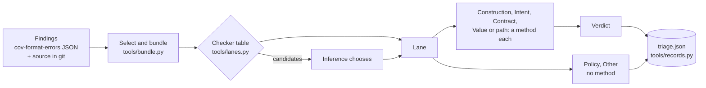

# coverity-triage

Part of [CoveritySkills](../README.md).

Triages Coverity findings **in lanes**. A finding is a claim, and the
question triage has to answer depends on the kind of claim:

| lane | the claim | the question |
|---|---|---|
| **Construction** | the construct does the wrong thing, or something undefined, for some input it can receive | is the construct actually there? (never "is the bad input likely?") |
| **Intent** | well-defined code that a pattern suggests the author may not have meant | what did the author mean, and does the code do it? |
| **Contract** | a call ignores a failure its callee can report, or uses a result that can be invalid | what is the callee's contract, can it fail for this call, does the caller rely on success? |
| **Value or path** | a value or state reaches a point, along a path, that does not handle it | is the path feasible, and is the value handled at the point? |
| **Policy** | a match against a rule set, a don't-call list or a threshold | none: never triaged, the rule decides |
| **Other** | not a claim about the code, or nothing fits | none: no method, no verdict |

**Most findings get their lane from a checker table**, with no model
involved: one row per checker, covering the C checkers of Coverity
2025.9.0. **Inference runs only for the few checkers whose findings vary**,
and chooses among that checker's candidate lanes. A custom checker is placed
once, with a row of its own, and a producer can ship the rows for its
checkers.

**Each lane has a preferred method:** an LLM reading with the lane's
questions and **its own model**, execution through
[coverity-verify](../coverity-verify/README.md), or a person. A checker
built for a particular method takes that one, and a user can give any
single finding any method.

The verdict lands where verdicts already go: Classification, Action,
Severity and Comment. Two custom attributes, `Defect Category` (the lane)
and `Triage Method`, record which lane the finding took and which method
produced its verdict.



## What it will not do on its own

**Spend.** Every lane method costs model time (or build and fuzz time) per
finding, so nothing runs until the selection (which findings) and the plan
(which method and model per lane) are chosen. `tools/bundle.py --plan` and
`tools/lanes.py assign` show the counts for free. Unattended, the skill does
those free steps, reports what it needs and stops, leaving the work on disk
to resume from. A skill that hands its findings here, such as
[coverity-demo-data](../coverity-demo-data/README.md), asks its user first,
and "no triage" is always one of the answers.

**Write to Connect.** The output is a records file in Connect's own
attribute names. Applying it, with or without the custom attributes, is the
job of whoever owns the instance.

## What the skill knows that saves time

- **The source is read from git at the analyzed version**, never from the
  working tree, and split on the line terminators a C compiler counts: one
  form feed in a file otherwise shifts every excerpt after it a line away
  from the line Coverity reported. With no git source, the intermediate
  directory's own copy is the backup (`cov-manage-emit extract-files`, with
  the installation that wrote it); the idir is only read.
- **A merge key can be reported at several sites** (copy-pasted code in two
  files); the bundle shows all of them and the record covers all of them.
- **A dismissal must be falsifiable**: a global-invariant verdict names the
  invariant, where it is enforced and what would break it, and the records
  tool refuses one that does not.
- **A confirmation needs the same reading**: a verdict resting on a callee
  nobody read is `unresolved`, in either direction.
- **A NUL in a triage comment** (from a C `'\0'` quoted into the argument)
  makes Connect refuse the whole triage write; the records tool refuses it
  first.

## Layout

```
coverity-triage/
├── SKILL.md                     # select → bundle → assign a lane → lane methods → records → report
├── CALIBRATION.md               # what was run, on what, and what was not
├── references/
│   ├── lanes.md                 # the six lanes, the tests, the table, custom checkers, methods
│   ├── checker-lanes.json       # the checker table: a lane, or candidates, per C checker
│   ├── reading.md               # each lane's questions, the verdict set and its discipline
│   └── records.md               # the table format, run.json, lanes.json, verdict files, triage.json
├── tools/
│   ├── bundle.py                # selection (--merge-key, --per-checker, --all), --plan, bundles
│   ├── lanes.py                 # lanes from the checker table; pending and unplaced; check-table
│   └── records.py               # assemble (all checks before any write) and validate
└── evals/
    ├── evals.json               # behaviour: asks before spending, unattended stop, Policy, refusals
    └── test_tools.py            # the three tools on a generated fixture, refusals and overrides included
```

## Requirements

- The findings as `cov-format-errors --json-output-v10` from the analyzed
  idir, and the source in git at the analyzed tag or commit; or, as the
  backup, the idir and the Coverity installation that wrote it.
- Python 3, standard library only; git.
- For the execution method only: what `coverity-verify` needs (the idir, the
  Coverity version that wrote it, clang with libFuzzer and ASan).
