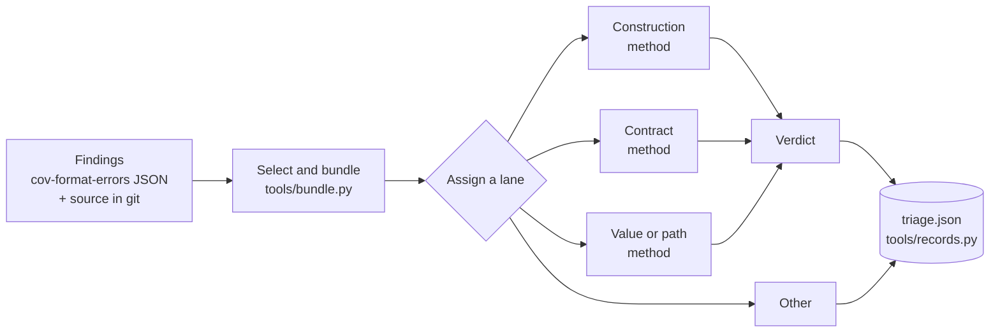

# coverity-triage

Part of [CoveritySkills](../README.md).

Triages Coverity findings **in lanes**. A finding is a claim, and the
question triage has to answer depends on the kind of claim:

| lane | the claim | the question |
|---|---|---|
| **Construction** | the code is built in a way the organization has chosen to disallow, whatever data reaches it | is the construct actually there? |
| **Contract** | a call ignores a failure its callee can report, or uses a result that can be invalid | what is the callee's contract, can it fail for this call, does the caller rely on success? |
| **Value or path** | a value or state reaches a point, along a path, that does not handle it | is the path feasible, and is the value handled at the point? |
| **Other** | none of the three | none: no method, no verdict |

Each finding is assigned a lane (by an LLM that reads the checker, the
events and the code, and never gives a verdict), and each lane invokes its
own method: an LLM reading with the lane's questions and **its own model**,
execution through [coverity-verify](../coverity-verify/README.md) for the
value-or-path lane, or a person. The verdict lands where verdicts already
go -- Classification, Action, Severity, Comment -- and two custom attributes,
`Triage lane` and `Triage method`, record which lane the finding took and
which method produced its verdict. Methods can change lane by lane later
without changing how findings flow or where verdicts land.



## What it will not do on its own

**Spend.** Every lane method costs model time (or build and fuzz time) per
finding, so nothing runs until the selection (which findings) and the plan
(which method and model per lane) are chosen. `tools/bundle.py --plan`
shows the counts for free. A skill that hands its findings here, such as
[coverity-demo-data](../coverity-demo-data/README.md), asks its user first,
and "no triage" is always one of the answers.

**Write to Connect.** The output is a records file in Connect's own
attribute names. Applying it, with or without the custom attributes, is the
job of whoever owns the instance.

## What the skill knows that saves time

- **The source is read from git at the analyzed version**, never from the
  working tree, and split on the line terminators a C compiler counts: one
  form feed in a file otherwise shifts every excerpt after it a line away
  from the line Coverity reported. With no git source, the intermediate
  directory's own copy is the backup (`cov-manage-emit extract-files`, with
  the installation that wrote it); the idir is only read.
- **A merge key can be reported at several sites** (copy-pasted code in two
  files); the bundle shows all of them and the record covers all of them.
- **A dismissal must be falsifiable**: a global-invariant verdict names the
  invariant, where it is enforced and what would break it, and the records
  tool refuses one that does not.
- **A confirmation needs the same reading**: a verdict resting on a callee
  nobody read is `unresolved`, in either direction.
- **A NUL in a triage comment** (from a C `'\0'` quoted into the argument)
  makes Connect refuse the whole triage write; the records tool refuses it
  first.

## Layout

```
coverity-triage/
├── SKILL.md                     # select → bundle → assign a lane → lane methods → records → report
├── CALIBRATION.md               # what was run, on what, and what was not
├── references/
│   ├── lanes.md                 # the lanes, Other, deciding a lane for any checker
│   ├── reading.md               # each lane's questions, the verdict set and its discipline
│   └── records.md               # run.json, lanes.json, verdict files, triage.json; the mappings
├── tools/
│   ├── bundle.py                # selection (--merge-key, --per-checker, --all), --plan, bundles
│   └── records.py               # assemble (all checks before any write) and validate
└── evals/
    ├── evals.json               # behaviour: asks before spending, Other, no-location refusals
    └── test_tools.py            # both tools on a generated fixture, refusals and overrides included
```

## Requirements

- The findings as `cov-format-errors --json-output-v10` from the analyzed
  idir, and the source in git at the analyzed tag or commit; or, as the
  backup, the idir and the Coverity installation that wrote it.
- Python 3, standard library only; git.
- For the execution method only: what `coverity-verify` needs (the idir, the
  Coverity version that wrote it, clang with libFuzzer and ASan).
