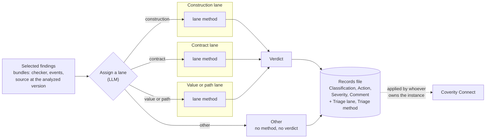

# Coverity triage

A finding is a claim, and claims come in kinds. "This query is assembled
from a non-constant string" holds whatever data reaches the code. "This
call ignores a failure its callee can report" is about a contract between
two functions. "This pointer is NULL when it reaches this dereference" is
about a value travelling along a path. Each kind needs a different
question answered, and can be answered by a different method. Asking all
of them the same question, with the same prompt and the same model, is
the reason a single-prompt triage is hard to improve: there is nowhere to
change one kind without changing the others.

So triage runs in lanes:

- **Each finding is assigned to one lane,** by the kind of claim it makes.
  If none of the three fits, it is assigned to **Other** and nothing
  further is done. The assigner is never forced to choose between lanes
  that do not fit.
- **Each lane invokes a method:** an LLM reading with the lane's own
  questions and its own model, an execution tool such as
  `coverity-verify`, or a person.
- **The method returns a verdict,** and the verdict goes where verdicts
  already go: Classification, Action, Severity and the triage Comment.
- **Two attributes record what happened:** `Triage lane` and `Triage
  method`.

Methods can change lane by lane later, and the lanes themselves can be
revised, without changing how findings flow or where verdicts land.



Read `coverity/RULES.md` first: rules 22, 23, 26 and 30 carry most of the
weight here.

## Scope

**This skill** bundles the selected findings, assigns lanes, runs each
lane's method, and writes the records and a report.

**It does not:**
- **Choose the findings.** The selection comes from the user or from the
  skill that produced the findings (a per-checker sample, the keys a story
  surfaced, a list from Connect). This skill offers the selection tools; it
  does not widen a selection it was given.
- **Decide what is in scope.** Which code was captured and which checkers
  were enabled were decided before analysis (`coverity` skill, rules 2 and
  9-11). A finding in code that should not have been captured is a capture
  question, not a verdict.
- **Rank severity or judge exploitability.** The verdict set has one
  severity word, *low severity*, and nothing more.
- **Write to Connect.** It writes a records file in Connect's attribute
  names. Applying it, with or without the two custom attributes, belongs
  to whoever owns the instance (*Records, and getting them to Connect*).
- **Use Connect's AI-Assisted Triage.** Its methods run where this skill
  runs, and the records say which ones ran.
- **Decide what is worth showing.** A correct verdict on a finding nobody
  can follow in a demo is still a correct verdict; demo-worthiness belongs
  to `coverity-demo-data`.

## Cost: nothing starts on a default

Every lane method spends model time, or build and fuzz time, per finding.
So two things are fixed before any method runs:

1. **The selection**: which findings, and how many.
2. **The plan**: the method for each lane, and its model, and the model
   for the lane assignment.

When the user, or the skill handing off, has fixed both, run. When either
is missing, show the plan with its counts (`tools/bundle.py --plan`) and
ask once. A question that names the numbers is cheap; a triage nobody
chose is not. Any lane can be left out of a plan (method `None`): its
findings still get their lane, and no verdict.

A skill that hands findings to this one asks its own user first. It never
triages because a step in its procedure came up.

## Step 0: The inputs

| input | where it comes from |
|---|---|
| the findings | `cov-format-errors --dir <idir> --json-output-v10 <file>` on the analyzed idir (rule 26 lists the fields). A Connect CID is turned into a merge key and the idir's findings with `coverity-verify/tools/cid_lookup.py` |
| the source at the analyzed version | **the default:** a git repository and the tag or commit the idir was built from. **Read from git, never from the working tree**: a working tree holds whatever was checked out last, which is the wrong source in a way that reads as entirely plausible. **The backup, when there is no git source** (an analyzed tree with no tag or commit to read): the intermediate directory, with the `bin/` of the installation that wrote it (rule 3) |
| the build root | the path prefix to strip from recorded paths (`--strip-prefix`) |
| the selection | `--merge-key` for named findings (repeatable), `--per-checker N` for rule 26's stratified sample, `--all` for every finding |
| the plan | the method per lane (*Step 3*), and the assigner's model |

## Step 1: Bundle the selection

```
python3 tools/bundle.py --issues <findings.json> --git-repo <repo> --tag <tag> \
    --strip-prefix <build-root> [--per-checker N] [--merge-key K ...] [--all] \
    --out <dir> [--plan]
```

With no git source, replace `--git-repo` and `--tag` with `--idir <idir>
--cov-bin <install>/bin` (and `--tag <label>` if the idir's directory name
is not a good one). The tool then reads the source the idir holds, with
`cov-manage-emit extract-files`. Git stays the default because it is faster
and does not depend on a Coverity installation. One source per run. The idir
is only read: one filed under another machine's host name is refused, since
`reset-host-name` would change it; run that on a copy, or use git. A
`--cov-bin` of a different version from the one that wrote the idir is
refused too.

`--plan` prints what the selection holds (total, per checker, why each was
selected) and writes nothing: run it first when the plan is not fixed.
Without it the tool writes one self-contained markdown bundle per finding
(`NNN-CHECKER.md`: the checker, the merge key, every site the merge key was
reported at, the full event trace, and the source around every event, read
with `git show <tag>:<path>` or from the idir), an `INDEX.md`, and
`index.json`, which the
records step reads. A bundle is enough for a reader, human or model, to
reach a verdict without the build machine.

The sample is deterministic (sorted by merge key), so a re-run bundles the
same findings and its verdicts stay comparable.

## Step 2: Assign a lane

The assignment is a step with a method of its own: an LLM reads each
bundle's checker, events and code and returns a lane and a one-sentence
reason. It never returns a verdict.

| lane | the claim | examples |
|---|---|---|
| **Construction** | the code is built in a way the organization has chosen to disallow, whatever data reaches it | SQL_NOT_CONSTANT, LDAP_NOT_CONSTANT |
| **Contract** | a call ignores a failure its callee can report, or uses a result that can be invalid | CHECKED_RETURN, NULL_RETURNS |
| **Value or path** | a value or state reaches a point, along a path, that does not handle it | FORWARD_NULL, OVERRUN, DIVIDE_BY_ZERO, UNINIT, NEGATIVE_RETURNS, RESOURCE_LEAK, DEADCODE |
| **Other** | fits none of the three; no method, no verdict | none expected |

`references/lanes.md` has the questions that decide a lane for a checker
not in the table, and the rule that **the claim decides, not the checker
name**: most checkers map to one lane, and the events can show that a
particular finding belongs in another. When they do, follow the events and
say so in the reason. An organization that keeps its own checker table
gives it to the assigner as the starting point; the assigner still reads
the events.

Write `lanes.json` (format in `references/records.md`) and name the model
that assigned. The assignment is cheap next to the lane methods, and a
misrouted finding gets the wrong method, so give it a model that reads
event traces well; the model running this skill is the default.

### When the caller expects a lane

A skill that hands findings over may have built them for one lane and one
method. `coverity-pathout`'s candidates, for instance, are built to be run:
the caller expects them in value or path, with execution through
`coverity-verify`. They still go through the assignment, since it is cheap
and it is the only check that the claim really is what the producer
assumed.

When a finding lands anywhere else (another lane, or Other), **say so
before any method runs**, list those findings with their lanes and reasons,
and let the user decide, per finding or per group:

- **run the expected method anyway**, where that is realistic (`coverity-verify`
  itself reports a claim it cannot instrument as *not a fuzz-triage
  candidate* rather than attempting it);
- **run the method of the lane it landed in**, such as a reading;
- **leave it untriaged** (method `None`).

Any of these is a sound choice. What is not acceptable is a finding taking
a different method, or none, by surprise. The user's choices go into
`run.json` as overrides with their reasons, so each record names the
method that actually produced its verdict and why.

## Step 3: Run each lane's method

| method | lanes | `Triage method` value | what runs |
|---|---|---|---|
| **Reading by an LLM** | any | `LLM: <model>`, e.g. `LLM: Sonnet 5.5` | subagents on that model read the lane's bundles against the lane's questions in `references/reading.md` and return one verdict per finding |
| **Execution** | value or path; another lane's finding only by the user's choice | `Execution: coverity-verify` | each finding goes to `coverity-verify` (Steps 0-4); its tier becomes the verdict (mapping in `references/records.md`). Needs the idir, the Coverity version that wrote it, and clang with libFuzzer |
| **A person** | any | `Human` | the bundles are the hand-off; the record carries the lane and method, and waits for the person's verdict |
| **Not run** | any | `None` | the plan left the lane out; its findings keep their lane and get no verdict |

A finding in **Other** gets method `None`, unless the user chose a method
for it (an override, with its reason).

**Reading, in practice.** One subagent per lane per batch of about ten
bundles, on the lane's model. Give it the lane's section of
`references/reading.md`, the verdict set, and its bundles, and nothing
from other lanes. It writes one verdict file (format in
`references/records.md`) and states the model it ran on. It reads the
code the argument depends on, including the callees the events go
through; when it has not, the verdict is `unresolved`, in either
direction. A reader that thinks a finding is in the wrong lane returns
`unresolved` with the reason `wrong lane: <lane>` instead of answering the
other lane's question, so a re-route is a deliberate second pass, not a
silent one.

**Execution, in practice.** Follow `coverity-verify` per finding. Its
report is the evidence; translate its verdict with the table in
`references/records.md`, mark the verdict executed, and put the tier and
the reach count in the reason. A finding verify reports as *not a
fuzz-triage candidate* or *unconfirmed* gets no verdict from this method.
Nothing falls back to reading unless the plan says so, because the record
must name the one method that produced its verdict.

## Step 4: Assemble the records

```
python3 tools/records.py assemble --bundles <dir> --lanes lanes.json \
    --verdicts <dir of verdict files> --run run.json --out <dir>/triage.json
python3 tools/records.py validate <dir>/triage.json
```

`assemble` joins the bundles, the lanes and the verdicts by merge key and
writes `triage.json` and `TRIAGE-REPORT.md`. It writes **nothing** when a
check fails, and it checks every finding it was given:
- every bundled finding has exactly one lane, and every lane value is one
  of the four;
- every finding whose method ran has a verdict, and a finding in Other or
  in a lane left out of the plan has none, unless an override with a
  reason says otherwise;
- every verdict is a word from the verdict set, and every method value is
  one of the four forms;
- **a `false positive - global invariant` names the invariant, where it is
  enforced, and what would break it** (rule 30: no location, no dismissal);
- no comment carries a control character other than tab, LF or CR, and no
  comment exceeds Connect's limit.

The verdict maps onto Connect's fields as follows; the comment carries the
argument, the lane and its reason, and the method.

| verdict | Classification | Action | Severity |
|---|---|---|---|
| `real` | Bug | Fix Required | |
| `real, low severity` | Bug | Fix Required | Minor |
| `intentional` | Intentional | Ignore | |
| `false positive - global invariant` | False Positive | Ignore | |
| `false positive - heuristic misfire` | False Positive | Ignore | |
| `unresolved`, Other, method not run or awaiting a person | not set | not set | |

A blank cell means the record leaves that field alone. Every record sets
the two custom attributes.

## Step 5: Report

Verdict first (rule 21), and **name the triager and where it ran** in the
same line: "read locally by 4 subagents on Opus 5.5 and 1 on Sonnet 5.5;
nothing written to Connect". Then the counts per lane, method and verdict,
from `TRIAGE-REPORT.md`, and what was not triaged: findings not selected,
findings in Other, lanes left out of the plan, `unresolved` verdicts
(rule 22). A sample is a sample: "triaged 18 of 147 findings across 13
checkers", never a false-positive rate for the run (rule 26). Mark what
was executed and what was read (rule 23).

## Records, and getting them to Connect

`triage.json` is one record per finding, keyed by **merge key** (a CID is
a label local to one Connect database; rule 27), with the triage state in
the attribute names Connect's triage-store export uses. Format and field
rules: `references/records.md`.

Applying it is not this skill's step. Whoever owns the instance decides,
per apply, whether to set the standard attributes only or the two custom
attributes as well. The custom ones are pick lists that must exist on the
instance before anything can set them, with a value for every method that
will be recorded (one per model). Creating attribute definitions takes the
v9 SOAP configuration service's `createAttribute`, which
`coverity-cvss-report/tools/cvss_attributes.py` uses for its own
attributes; REST and `cov-manage-im` cannot create them.

## Handing off to this skill

A skill that produces findings (`coverity-demo-data`'s datasets,
`coverity-pathout`'s candidates, a findings file from any run) hands off
with the inputs of Step 0, after its user has chosen the selection and the
plan, and says which lane and method it expects, if any (*When the caller
expects a lane*). It gets back the bundles, `triage.json` and
`TRIAGE-REPORT.md`, and keeps its own concerns: which findings a story
surfaces, whether a true positive is legible on screen.

## Anti-patterns

- Starting a triage the user did not choose, or widening the selection
  (a sample into `--all`, one lane into three) because it seemed thorough.
- Letting the assigner give a verdict, or a reader answer another lane's
  question instead of returning `wrong lane`.
- A dismissal with no location: report `unresolved` instead (rule 30).
- A confirmation resting on a callee nobody read: `unresolved` too. A
  caveat is not a verdict.
- Reading source from the working tree instead of `git show <tag>:<path>`,
  or from the idir.
- Quoting a sample as the run's false-positive rate.
- Reporting verdicts without naming who produced them and where, or
  calling them AI-Assisted Triage when they were not.
- Falling back from one method to another for a finding without the plan
  saying so: the record then names a method that did not produce its
  verdict.
- Quietly running a different method, or none, on a finding that did not
  land in the lane its caller expected. Report it and let the user choose.
- Writing triage to Connect from this skill.

## Where other skills take over

| Question | Skill |
|---|---|
| Verify one finding by running it; "was this fixed or silenced?" | `coverity-verify` |
| A defect history dated per release; a dataset for adoption or a demo, and which of its findings a story should show | `coverity-demo-data` |
| Candidates from functions that reached the path bound | `coverity-pathout` |
| The sample looks noisy: is the capture sound? | `coverity` (rules 2, 9, 26) |
| A CVSS score per finding | `coverity-cvss-report` |

## Layout

```
coverity-triage/
├── SKILL.md
├── README.md
├── CALIBRATION.md               # what was run, on what, and what was not
├── references/
│   ├── lanes.md                 # the lanes, Other, assigning a checker not in the table
│   ├── reading.md               # the reading method: each lane's questions, the verdict set
│   └── records.md               # lanes.json, verdict files, run.json, triage.json; the mappings
├── tools/
│   ├── bundle.py                # select + bundle: trace and source from git at the tag (or the idir); --plan
│   └── records.py               # assemble + validate the records; TRIAGE-REPORT.md
└── evals/
    ├── evals.json
    └── test_tools.py            # the two tools on a generated fixture, negatives included
```
