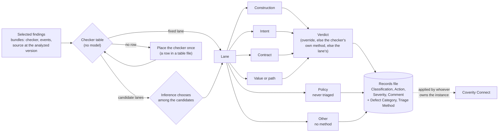

# Coverity triage

A finding is a claim, and claims come in kinds:

- "This query is assembled from a non-constant string" holds whatever data
  reaches the code.
- "This case falls through into the next" is true of the code, and the open
  question is whether the author meant it.
- "This call ignores a failure its callee can report" is about a contract
  between two functions.
- "This pointer is NULL when it reaches this dereference" is about a value
  travelling along a path.

Each kind needs a different question answered, and can be answered by a
different method. Asking all of them the same question, with the same
prompt and the same model, is why a single-prompt triage is hard to
improve: there is nowhere to change one kind without changing the others.

So triage runs in lanes:

- **Each finding gets one lane**, by the kind of claim it makes. A checker
  table fixes the lane for most checkers, with no model involved. Inference
  chooses only for checkers whose findings can make more than one kind of
  claim, and only among that checker's candidate lanes.
- **Policy findings are never triaged.** A match against MISRA, a don't-call
  list or a threshold is the rule authors' decision.
- **Other** is for what fits no lane, and nothing further is done.
- **Each lane has a preferred method:** an LLM reading with the lane's
  questions and its own model, an execution tool such as `coverity-verify`,
  or a person. **A checker's own method overrides it**, and the user's
  choice for a single finding overrides both. No lane restricts methods.
- **The method returns a verdict,** and the verdict goes where verdicts
  already go: Classification, Action, Severity and the triage Comment.
- **Two attributes record what happened:** `Defect Category` (the lane) and
  `Triage Method`.

Lanes exist to choose a method for checkers that cannot say how they should
be triaged. Methods can change lane by lane later, and the table can move a
checker, without changing how findings flow or where verdicts land.



Read `coverity/RULES.md` first: rules 22, 23, 26, 30 and 38 carry most of
the weight here.

## Scope

**This skill** bundles the selected findings, assigns lanes, runs each
lane's method, and writes the records and a report.

**It does not:**
- **Choose the findings.** The selection comes from the user or from the
  skill that produced the findings (a per-checker sample, the keys a story
  surfaced, a list from Connect). This skill offers the selection tools; it
  does not widen a selection it was given.
- **Decide what is in scope.** Which code was captured and which checkers
  were enabled were decided before analysis (`coverity` skill, rules 2 and
  9-11). A finding in code that should not have been captured is a capture
  question, not a verdict.
- **Rank severity or judge exploitability.** The verdict set has one
  severity word, *low severity*, and nothing more.
- **Second-guess a policy.** Policy findings carry their lane and nothing
  else.
- **Write triage to Connect.** It writes a records file in Connect's
  attribute names. Applying it, with or without the two custom attributes,
  belongs to whoever owns the instance (*Records, and getting them to
  Connect*). The one thing it writes to an instance, and only when asked, is
  the definition of those two attributes.
- **Use Connect's AI-Assisted Triage.** Its methods run where this skill
  runs, and the records say which ones ran.
- **Decide what is worth showing.** A correct verdict on a finding nobody
  can follow in a demo is still a correct verdict; demo-worthiness belongs
  to `coverity-demo-data`.

## Cost: nothing starts on a default

Every lane method spends model time, or build and fuzz time, per finding.
So three things are fixed before any method runs:

1. **The selection**: which findings, and how many.
2. **The plan**: a method for each of the four method lanes (`None` when a
   lane is left out), its model, and the model for inference.
3. **The rows for any checker the table does not have** (*Step 2*).

When the user, or the skill handing off, has fixed all of them, run. When
any is missing, the next step depends on whether someone is there to
answer (rule 38):

- **Interactive:** ask once, with the counts, and say what each answer
  costs. A question that names the numbers is cheap; a triage nobody chose
  is not.
- **Not interactive, or unsure which:** do the free steps (bundles, lanes
  from the table), report what is needed, and stop. The report gives:
  - what is done (the bundles, and `lanes.json` with the table's lanes);
  - what is needed (the counts per lane, the findings left for inference,
    any checker to place, and the plan to choose);
  - the command or answer that continues.

  The work stays on disk, so the next session resumes from it. Nothing is
  inferred from a TTY, an environment variable or the shape of the
  invocation.

A plan or an override already in the inputs is not a question, and that
part runs. A default that looks cheap is still a decision nobody made:
neither `Human` nor `None` stands in for a lane nobody planned. The tools
refuse a plan that leaves any method lane out.

A skill that hands findings to this one asks its own user first. It never
triages because a step in its procedure came up.

## Step 0: The inputs

| input | where it comes from |
|---|---|
| the findings | `cov-format-errors --dir <idir> --json-output-v10 <file>` on the analyzed idir (rule 26 lists the fields). A Connect CID is turned into a merge key and the idir's findings with `coverity-verify/tools/cid_lookup.py` |
| the source at the analyzed version | **the default:** a git repository and the tag or commit the idir was built from. **Read from git, never from the working tree**: a working tree holds whatever was checked out last, which is the wrong source in a way that reads as entirely plausible. **The backup, when there is no git source** (an analyzed tree with no tag or commit to read): the intermediate directory, with the `bin/` of the installation that wrote it (rule 3) |
| the build root | the path prefix to strip from recorded paths (`--strip-prefix`) |
| the selection | `--merge-key` for named findings (repeatable), `--per-checker N` for rule 26's stratified sample, `--all` for every finding |
| the checker tables | the skill's own `references/checker-lanes.json`, plus any organization or producer table (`--table`, *Step 2*) |
| the plan | the method per lane (*Step 3*), the model for inference, and optionally a verify route for the whole plan |
| the by-catch folder | where defects noticed outside the selected findings go: `<out>/bycatch/`, beside the records and never in them, or a folder the caller names (`references/records.md`, *By-catch*) |

## Step 1: Bundle the selection

```
python3 tools/bundle.py --issues <findings.json> --git-repo <repo> --tag <tag> \
    --strip-prefix <build-root> [--per-checker N] [--merge-key K ...] [--all] \
    --out <dir> [--plan]
```

**With no git source,** replace `--git-repo` and `--tag` with `--idir <idir>
--cov-bin <install>/bin`, plus `--tag <label>` if the idir's directory name
is not a good one. The tool then reads the source the idir holds, with
`cov-manage-emit extract-files`. Git stays the default, because it is faster
and does not depend on a Coverity installation. Rules for the idir:

- One source per run.
- The idir is only read. An idir filed under another machine's host name is
  refused, since `reset-host-name` would change it: run that on a copy, or
  use git.
- A `--cov-bin` of a different version from the one that wrote the idir is
  refused too.

**`--plan`** prints what the selection holds (total, per checker, and why
each was selected) and writes nothing. Run it first when the selection is
not fixed.

**Without `--plan`,** the tool writes:

- one self-contained markdown bundle per finding (`NNN-CHECKER.md`). It holds
  the checker, the merge key, every site the merge key was reported at, the
  full event trace, and the source around every event, read with `git show
  <tag>:<path>` or from the idir;
- an `INDEX.md`;
- `index.json`, which the lanes and records steps read.

A bundle is enough for a reader, human or model, to reach a verdict without
the build machine.

The sample is deterministic (sorted by merge key), so a re-run bundles the
same findings and its verdicts stay comparable.

## Step 2: Assign a lane

```
python3 tools/lanes.py assign --bundles <dir> [--table <file> ...] --out <dir>/lanes.json
```

`references/lanes.md` has the lanes, the tests that decide one, and the
rules below in full.

1. **From the checker table, with no model.** A finding whose checker has a
   fixed lane takes it. The skill's table covers the checkers whose
   languages include C in Coverity 2025.9.0. An organization's own table,
   or a producer's rows for its custom checkers, follows it through
   `--table`, and a later row replaces an earlier one.
2. **Inference, only where the table gives candidates.** For a checker whose
   findings vary (NEGATIVE_RETURNS: a callee's negative return, or a
   variable tested negative), `lanes.py` leaves the finding pending with its
   candidate lanes. Inference reads the events and code, chooses one of
   those candidates, and gives a one-sentence reason that names the
   deciding events. It never returns a verdict. It runs on the plan's
   `assigner` model, which the plan has fixed: the step reads event traces,
   and a misrouted finding gets the wrong method.
3. **A custom checker with no row is placed once**, not per finding. Its
   row comes from the producer's rows if it ships any, from the built-in
   checker it stands in for, or from its description. A checker that is
   noisy by design, built to be verified, carries the method
   `Execution: coverity-verify` in its row. Interactive, show the proposed
   rows and ask; otherwise report them and stop (rule 38). Either way, write
   them to a table file the user keeps, and run `assign` again with it.

`lanes.py` writes `lanes.json` even when findings are pending: the table's
work is kept, and it prints what is left.

### When the caller expects a lane

A skill that hands findings over may have built them for one lane and one
method. Its rows can say so directly. A checker whose row carries its own
method gets that method whatever lane it lands in, and is never off-lane.

Any other finding that lands outside the expected lane, other than a Policy
finding, is reported **before any method runs**. Report it with its lane and
reason, and let the user choose, per finding or per group:

- **run the expected method anyway**, where that is realistic (`coverity-verify`
  itself reports a claim it cannot instrument as *not a fuzz-triage
  candidate* rather than attempting it);
- **run the method of the lane it landed in**, such as a reading;
- **leave it untriaged** (method `None`).

Any of these is a sound choice. What is not acceptable is a finding taking
a different method, or none, by surprise. The user's choices go into
`run.json` as overrides, with their reasons, so each record names the method
that actually produced its verdict and why. Unattended, the list is the
report, and the run stops there (rule 38). `records.py check-lanes` prints
it.

## Step 3: Run each lane's method

| method | `Triage Method` value | what runs |
|---|---|---|
| **Reading by an LLM** | `LLM: <model>`, e.g. `LLM: Sonnet 5.5` | subagents on that model read the lane's bundles against the lane's questions in `references/reading.md` and return one verdict per finding |
| **Execution** | `Execution: coverity-verify` | each finding goes to `coverity-verify`, whose router runs it on its harness or extraction route; its tier becomes the verdict (mapping in `references/records.md`). Needs the idir, the Coverity version that wrote it, and clang with libFuzzer |
| **A person** | `Human` | the bundles are the hand-off; the record carries the lane and method, and waits for the person's verdict |
| **Not run** | `None` | the plan left the lane out; its findings keep their lane and get no verdict |

**Any method may be planned for any of the four method lanes**, and a
user's override may give any finding any method: a closer look at single
defects is always on offer. A finding's method is the first that applies:

1. the override for that finding;
2. its checker's own method (the table row);
3. the plan's method for its lane.

A finding in **Policy** takes no method, ever. A finding in **Other** takes
`None` unless an override gives it one, with the reason.

**Reading, in practice.**

- **Batches:** one subagent per lane per batch of about ten bundles, on the
  lane's model.
- **What the reader gets:** that lane's section of `references/reading.md`
  and the verdict set, plus its bundles. Nothing from other lanes, and
  nothing about why the findings were selected.
- **What it writes:** one verdict file (format in `references/records.md`),
  stating the model it ran on. Any by-catch goes in a separate file in the
  by-catch folder the reader is given, never in a verdict.
- **What it reads:** the code the argument depends on, including the
  callees the events go through. When it has not read them, the verdict is
  `unresolved`, in either direction.
- **When it disagrees with the lane:** it returns `unresolved` with the
  reason `wrong lane: <lane>`, instead of answering the other lane's
  question, so a re-route is a deliberate second pass rather than a silent
  one.

**Execution, in practice.**

- **The route.** Send each finding to `coverity-verify` with its route
  preference: the override's `route`, else the plan's `verify_route`, else
  the row's `route`, else none, in which case verify's router uses its own
  shipped default. The router never switches route on its own: when the
  preferred route does not apply, verify reports *not verified: <route>
  does not apply*.
- **The evidence.** Verify's report is the evidence. Translate its tier with
  the table in `references/records.md`, mark the verdict executed, put the
  tier and the reach count in the reason, and copy verify's route and its
  inventory of what ran as code and what was stubbed.
- **No verdict.** A finding that verify reports as *not a fuzz-triage
  candidate*, *unconfirmed* or *not verified* gets no verdict from this
  method.
- **No fallback.** Nothing falls back to reading unless the plan says so,
  because the record must name the one method that produced its verdict.
- **Bycatch.** A crash verify's free run hits elsewhere is by-catch. It
  goes to the by-catch folder, never into the verdict's reason.

## Step 4: Assemble the records

```
python3 tools/records.py assemble --bundles <dir> --lanes lanes.json \
    --verdicts <dir of verdict files> --run run.json --out <dir>/triage.json
python3 tools/records.py validate <dir>/triage.json
```

`assemble` joins the bundles, the lanes and the verdicts by merge key, then
writes `triage.json` and `TRIAGE-REPORT.md`. It writes **nothing** when a
check fails, and it checks every finding it was given:

- nothing is still pending in `lanes.json`;
- every bundled finding has exactly one lane, from the six;
- a lane chosen by inference is one of the checker's candidates, and was
  chosen by the plan's assigner;
- the plan names a method for each method lane;
- every finding whose method ran has a verdict;
- a finding in Policy has no verdict and no override;
- a finding in Other, or in a lane left out of the plan, has no verdict,
  unless an override with a reason says otherwise;
- every verdict is a word from the verdict set, and every method value is
  one of the four forms;
- **a `false positive - global invariant` names the invariant, where it is
  enforced, and what would break it** (rule 30: no location, no dismissal);
- no comment carries a control character other than tab, LF or CR, and no
  comment exceeds Connect's limit;
- no verdict carries by-catch, as a field or in the usual by-catch phrasing;
- every by-catch file in the by-catch folder is well-formed, and names a
  bundled finding. Assemble collects them into `bycatch/bycatch.json`, and
  prints `by-catch: N item(s) in <path>` (or `by-catch: none`).

The verdict maps onto Connect's fields as below. The comment carries the
argument, the lane and who assigned it, and the method.

| verdict | Classification | Action | Severity |
|---|---|---|---|
| `real` | Bug | Fix Required | |
| `real, low severity` | Bug | Fix Required | Minor |
| `intentional` | Intentional | Ignore | |
| `false positive - global invariant` | False Positive | Ignore | |
| `false positive - heuristic misfire` | False Positive | Ignore | |
| `unresolved`, Policy, Other, method not run or awaiting a person | not set | not set | |

A blank cell means the record leaves that field alone. Every record sets
the two custom attributes.

## Step 5: Report

Lead with the verdict (rule 21), and **name the triager and where it ran**
in the same line: "read locally by 4 subagents on Opus 5.5 and 1 on Sonnet
5.5; nothing written to Connect". Then give:

- **the counts per lane, method and verdict**, from `TRIAGE-REPORT.md`;
- **how many lanes came from the table**, and how many from inference;
- **what was not triaged** (rule 22): findings not selected, findings in
  Policy, findings in Other, lanes left out of the plan, and `unresolved`
  verdicts.

A sample is a sample: "triaged 18 of 147 findings across 13 checkers",
never a false-positive rate for the run (rule 26). Mark what was executed
and what was read (rule 23).

**By-catch is reported beside the records, never in them.** Say how many
items there are, the path of `bycatch.json`, and that they are unverified
notes: defects to fix in your own code, or something for whoever handles
unreported vulnerabilities in code that is not yours. Interactive, say it
in the reply. Unattended, the stdout line from `assemble` is the report.
Nothing about by-catch goes into `TRIAGE-REPORT.md`, not even a count.

## Records, and getting them to Connect

`triage.json` holds one record per finding, keyed by **merge key** (a CID is
a label local to one Connect database; rule 27). It carries the triage state
in the attribute names that Connect's triage-store export uses. Format and
field rules: `references/records.md`.

Applying it is not this skill's step. Whoever owns the instance decides,
per apply, whether to set the standard attributes only or the two custom
attributes as well.

- The custom ones, `Defect Category` and `Triage Method`, are pick lists. They
  must exist on the instance, with a value for everything the records set
  (one `Triage Method` value per model), before anything can set them.
- `tools/connect_attributes.py` creates them over REST:

  ```
  python3 tools/connect_attributes.py check --url <connect-url> [--records triage.json] [--model "Sonnet 5.5"]
  python3 tools/connect_attributes.py setup --url <connect-url> [--records triage.json] [--model "Sonnet 5.5"] [--yes]
  ```

  - **`check`** reads the instance and says what is missing. It exits 3 when
    something is, and 0 when nothing is.
  - **`setup`** prints the same plan and changes nothing. With `--yes` it
    creates the missing attributes and adds the missing values. Run it once
    per instance, and again when a records file uses a new model.
  - **What it never does:** delete or rename an attribute or a value, or
    change an attribute's type.
  - **The two attributes are instance-global.** They appear in every
    project's triage pane, so only whoever owns the instance runs `setup
    --yes`. Interactive, ask them first; unattended, report the `check`
    output and stop (rule 38).
  - **Credentials and target:** an auth key file, by default
    `~/.coverity/ak-<host>-<port>` (the `coverity` skill's `connect_auth.py`
    writes it there). The URL comes from `--url` only, never from the key
    file (rule 28).

## Handing off to this skill

Most runs start from a user with a findings file: from any analysis, or
from a dataset `coverity-demo-data` built. A skill that produces findings
for triage, such as `coverity-pathout` with its candidates, hands off with
the inputs of Step 0, after its user has chosen the selection and the plan.
With its findings, it gives:

- the rows for its own custom checkers, if it has any, as a table file;
- which lane and method it expects, if any (*When the caller expects a
  lane*);
- where by-catch should go, if it has a destination of its own.

It gets back the bundles, `triage.json`, `TRIAGE-REPORT.md` and, when there
is any, `bycatch/bycatch.json`. It keeps its own concerns.

## Anti-patterns

- Starting a triage the user did not choose, or widening the selection
  (a sample into `--all`, one lane into three) because it seemed thorough.
- Treating a cheap method (`Human`, `None`) as a default for a lane nobody
  planned, or picking the inference model, a lane's model or the
  execution method unattended.
- Deciding at a decision point because nobody seems to be there. Report
  and stop instead, with the work kept and the command that continues it.
- Running inference on a finding the table already places, or letting it
  choose a lane outside the checker's candidates.
- Hard-coding one producer's checker names into the table. A producer
  ships rows for its own checkers.
- Triaging a Policy finding.
- Dismissing a Construction finding because the bad input is unlikely or
  far off.
- Letting the assigner give a verdict, or a reader answer another lane's
  question instead of returning `wrong lane`.
- A dismissal with no location: report `unresolved` instead (rule 30).
- A confirmation resting on a callee nobody read: `unresolved` too. A
  caveat is not a verdict.
- Reading source from the working tree instead of `git show <tag>:<path>`,
  or from the idir.
- Quoting a sample as the run's false-positive rate.
- Reporting verdicts without naming who produced them and where, or
  calling them AI-Assisted Triage when they were not.
- Falling back from one method to another for a finding without the plan
  saying so: the record then names a method that did not produce its
  verdict.
- Quietly running a different method, or none, on a finding that did not
  land in the lane its caller expected. Report it and let the user choose.
- Writing by-catch into a `reason`, a verdict file, `run.json` or the
  report. Those travel with the records; by-catch goes to `bycatch/`.
- Writing triage to Connect from this skill, or running `connect_attributes.py
  setup --yes` on an instance without its owner's say-so.

## Where other skills take over

| Question | Skill |
|---|---|
| Verify one finding by running it; "was this fixed or silenced?" | `coverity-verify` |
| A defect history dated per release; a dataset for adoption or a demo, and which of its findings a story should show (triage it afterwards, here, as a separate step) | `coverity-demo-data` |
| Candidates from functions that reached the path bound | `coverity-pathout` |
| The sample looks noisy: is the capture sound? A PARSE_ERROR? | `coverity` (rules 2, 9, 26) |
| A CVSS score per finding | `coverity-cvss-report` |

## Layout

```
coverity-triage/
├── SKILL.md
├── README.md
├── CALIBRATION.md               # what was run, on what, and what was not
├── references/
│   ├── lanes.md                 # the six lanes, the tests, the table, custom checkers, methods
│   ├── checker-lanes.json       # the checker table: C checkers in Coverity 2025.9.0
│   ├── reading.md               # the reading method: each lane's questions, the verdict set
│   └── records.md               # the table format, run.json, lanes.json, verdict files, triage.json
├── tools/
│   ├── bundle.py                # select + bundle: trace and source from git at the tag (or the idir); --plan
│   ├── lanes.py                 # lanes from the checker table; what is left for inference; check-table
│   ├── records.py               # assemble + validate the records; check-lanes; TRIAGE-REPORT.md
│   └── connect_attributes.py    # check / create Defect Category and Triage Method on a Connect (REST)
└── evals/
    ├── evals.json
    └── test_tools.py            # the tools on a generated fixture and a fake Connect, negatives included
```
